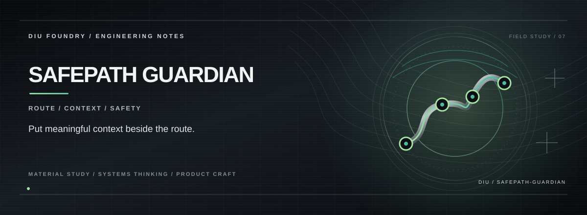

# SAFEPATH GUARDIAN

**A child-journey safety product concept focused on route context, explainable alerts, and parent/school workflows.**

SafePath Guardian explores how a safety interface could combine location context, route expectations, incident review, and escalation steps. The repository contains a React interface with sample data and explanatory flows. Its descriptions of wearables, cellular connectivity, predictive risk scoring, and escalation are proposed system behaviour—not proof that physical devices or live alert services are connected.

## The proposed safety loop

```text
Location / movement signals
        │
        ▼
Route and timing context
        │
        ▼
Potential anomaly + explanation
        │
        ▼
Parent / school review
        │
        ▼
Escalation pathway (requires real integration)
```

## Interface areas

- **Landing and how-it-works:** Explain the proposed product flow.
- **Parent and school views:** Explore different operator needs and information boundaries.
- **Route and location language:** Make journey context central to the experience.
- **Alert and escalation concepts:** Show how a concern could be communicated and reviewed.

## Stack

React · TypeScript · Vite · React Router · Leaflet-related map tooling · Tailwind CSS

## Run locally

**Requirements:** Node.js and npm.

```bash
git clone https://github.com/Kishordiu/safepath-guardian.git
cd safepath-guardian
npm ci
npm run dev
```

The local URL is printed by Vite. The repository also includes test tooling; run the configured tests before preparing a release.

## Non-negotiable safety boundary

**This is not a child-tracking service or emergency-response system.** Do not assume that GPS, a wearable badge, a cellular/GSM connection, geofencing, AI anomaly detection, pickup verification, SMS, email, or phone escalation are live or reliable because they are described in a concept screen. Do not use this prototype to make decisions about a real child's safety. A real deployment would require verified hardware and service integrations, robust consent and access controls, privacy/security review, field testing, and a documented emergency fallback.

---

<p align="center"><sub>DIU FOUNDRY · SAFETY EXPERIENCE / HUMAN-CENTRED SYSTEMS</sub></p>
